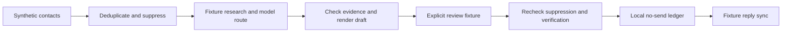

# Outbound orchestration demo

A local Python showcase of evidence-based routing, templated personalization, review, suppression checks, and idempotent upload simulation. Adapted from Clarity Works tooling by Vatsal Jain with AI-assisted development.

This demo uses invented contacts on reserved example domains. Research, model recommendations, verification results and review decisions are explicit fixtures. It has no network transport, sending credentials or live campaign integration. The upload stage writes a local JSON ledger; emails sent stays at zero.

## Run it

Python 3.11+, standard library only:

```sh
python3 -m outbound_demo
python3 -m unittest discover -s tests -v
```

Inspect `output/drafts.json`, `output/run.json` and `output/upload-ledger.json`. A saved [example run](examples/sample-run.json) is included. Run the demo a second time with the same output directory: it stages zero additional uploads because the ledger already contains that contact.

## What the example shows



The six input rows include an eligible contact, a pending review, an unsupported hiring claim, a do-not-contact record, an existing reply, and a duplicate. The first contact's model-recommended hiring campaign is overridden because the research contains no hiring signal. Only its reviewed draft reaches the simulated ledger. A subsequent fixture reply changes its ledger status to suppressed.

`examples/review-decisions.json` contains a prewritten **demonstration** approval, not a record of a real human reviewing this run. Its hash matches the destination, campaign, subject and body. To try another draft, inspect `output/drafts.json`, create an explicit decision for the current hash, and call the same review functions. The pending second contact remains blocked without that decision.

## Implementation boundaries

- `render.py` contains rendering helpers extracted from the production drafting stage.
- `rules.py` contains extracted punctuation and unsupported-hiring-claim checks.
- `pipeline.py` adapts the routing/review/upload boundaries to local records. The hash-bound review and file ledger are showcase additions.
- `examples/` contains invented research and model output. No language model is called and the demo does not evaluate model quality.
- `NoSendLedger` rechecks the current suppression/verification fixtures after review and prevents duplicate staging across reruns. It is a single-process file store, without transactional concurrency guarantees.

The approval hash detects edits or stale review files; it is not an authentication system. Anyone who controls both local JSON files can replace them. A production service needs trusted reviewer identity, permissions, durable state and concurrency control.

Verification status is synthetic. There is no external email verifier. The fixture parser accepts reserved example domains to keep this sample distinct from operational contact lists. No claim of legal compliance or deliverability follows from the demonstration.

## Why these checks matter

Model recommendations can invent a plausible campaign or hiring rationale. The router checks an allowed set and source evidence before selecting copy. Drafts without usable personalization remain blocked. Approval is a separate state, and suppression is checked again at upload time because a reply or opt-out can arrive after drafting.

Tests exercise those boundaries, changed content after approval, missing reviewer/verification, repeated runs, and reply sync. They do not measure production throughput or conversion rates.

The broader project is explained in the [outbound engine case study](https://www.vatsaljain.com/work/outbound-engine/). See [PROVENANCE.md](PROVENANCE.md) for extracted code and new adaptations. No open-source license has been assigned to this showcase.
